# Report answers and evidence checklist

> Evidence is grouped under `evidence/` by topic. See [EVIDENCE_GUIDE.md](EVIDENCE_GUIDE.md) for the supplied screenshots and verified GitHub run links.

**Course:** Data Engineering  
**Assignment:** From Git to Gold  
**Student:** Vanisha Garg  
**Roll number:** 23BCS254  
**Repository:** https://github.com/Vanisha1606/freshcard-pipelines

This report summarizes the supplied project files and evidence. The assignment brief was not present in the project folder, so deliverables are based on the requirements recorded in this report and `EVIDENCE_GUIDE.md`. The FreshCart notebook is sanitized: instructor credentials and outputs were removed, and the currency rule and sixth quality check were added. Snowflake and RabbitMQ results below are from the supplied screenshots. GitHub Actions results link to verified runs in this repository.

## A. Git and CI/CD

### A1. Repository

The public repository is [Vanisha1606/freshcard-pipelines](https://github.com/Vanisha1606/freshcard-pipelines). Key focused commits, newest first (the report refresh is not listed here):

```text
8182c0b Add grouped assignment evidence screenshots
8ca3c05 Remove unrelated GitHub history screenshot
c58fd70 Add RabbitMQ topic dispatcher and driver scripts
6692506 Add sanitized FreshCart notebook and SQL patterns
5b00b40 Add Mage Iris pipeline blocks and metadata
85ec629 Fix the Iris split back to 80/20
86325eb Demonstrate failing CI with a 70/30 Iris split
08b7042 Add GitHub Actions pytest workflow and required 80/20 split
3b54c94 Add project overview, dependencies, and secret ignores
```

### A2. Git command table

| Command | Where the change happens | What exactly happens |
|---|---|---|
| `git init` | Working folder and local Git metadata | Creates a `.git` repository so Git can track this folder. |
| `git add train.py` | Staging area | Stages the current file contents for the next commit. |
| `git commit -m "msg"` | Local repository | Saves a snapshot of staged changes as a local commit. |
| `git remote add origin URL` | Local Git configuration | Records the remote URL under the name `origin`. |
| `git push -u origin main` | Remote Git | Uploads local `main` commits and sets upstream tracking. |
| `git pull origin main` | Local working folder and local Git | Fetches remote commits and integrates them into the current branch. |

After `git commit`, a teammate cannot see the code on GitHub yet: the commit exists only in the local repository until pushed to a remote.

### A3. CI

`tests/test_prepare_data.py` checks for 120 training and 30 test rows. The initial 80/20 commit passed in [Actions run #1](https://github.com/Vanisha1606/freshcard-pipelines/actions/runs/43594287133). The separate 70/30 demonstration commit failed in [Actions run #2](https://github.com/Vanisha1606/freshcard-pipelines/actions/runs/43597144515): pytest reported 105 training rows instead of 120. The fix commit restored 80/20 and passed in [Actions run #3](https://github.com/Vanisha1606/freshcard-pipelines/actions/runs/43597230323). The default branch is green at the fix commit. The supplied GitHub history screenshot was removed because it showed another account; the links above are verified records for this repository.

## B. FreshCart ELT on Snowflake

The instructor notebook supplies the DDL, mock API fixtures and transformations. The target values from the assignment are compared with the captured baseline outputs below.

### B1. Baseline

| Check | Expected result from brief | Actual run |
|---|---:|---|
| Bronze raw orders | 8 per extraction | 16 in the final table after two append-only extractions |
| Silver clean | 6 | 6 |
| Quarantine | 2: ORD-1004, ORD-1006 | 2 |
| Deduplicated orders | 4 | 4 |
| Gold aggregate | 4 orders; ₹7,785.00; 126 points | 4 orders; ₹7,785.00; 126 points |
| Rejected share | 25% | 25% |

**Captured result:** one extraction contained 8 input records (6 web and 2 mobile). The final bronze-table screenshot shows 16 rows, consistent with two append-only extracts. Silver clean contains 6 rows, quarantine 2, deduplicated orders 4, and Gold 4 orders, ₹7,785.00 revenue, and 126 points. The run reports 25% rejected and zero for each displayed quality check.

**Evidence:** baseline summary, bronze source rows, silver rows, and quarantine/dedup results are in the Snowflake appendix. The separate connection screenshot is excluded because it displays account/user details.

### B2. Record trace

ORD-1003's website bronze JSON uses flat keys such as `order_id`, `cust_email`, `cust_name`, `order_date`, `amount`, and `updated_at`; the mobile bronze JSON uses `orderId`, nested `customer.email` and `customer.name`, `orderDate`, nested `total.value` and `total.currency`, `deliveryPin`, and `updatedAt`. `SQL_10_ORDERS_CLEAN` maps these with `raw:order_id::STRING` etc. for web and `raw:orderId::STRING`, `raw:customer.email::STRING`, `raw:total.value::STRING` etc. for mobile. Both become normalized `order_id`, `email`, `name`, `order_date`, `amount`, `currency`, `pincode`, and `updated_at`; `LOWER(TRIM(...))`, `INITCAP`, `COALESCE(TRY_TO_DATE(...))`, and `TRY_TO_DECIMAL(REGEXP_REPLACE(...))` standardize them. `SQL_20_ORDERS_DEDUP` keeps the later mobile row using `QUALIFY ROW_NUMBER() OVER (PARTITION BY order_id ORDER BY updated_at DESC, ingest_seq DESC) = 1`. Meera's order is INR 2,100, so the FX rate is 1; Platinum's multiplier is 3, giving `FLOOR(2100 / 100) × 3 = 21 × 3 = 63` points.

ORD-1005's date is 2026-09-03, when Priya's SCD2 tier becomes Gold. The order-date range join to `dim.customers_scd2` selects Gold, then `ref.tier_multiplier` joins on `m.tier = c.tier`; points are `FLOOR(899 / 100) × 2 = 8 × 2 = 16`. ORD-1001 is dated 2026-09-01, so the same point-in-time SCD2 join selects Silver, yielding `FLOOR(1250 / 100) × 1 = 12` points.

### B3. Currency validation

The submitted notebook adds `IFF(currency NOT IN ('INR', 'USD'), 'unsupported_currency', NULL)` to `ARRAY_CONSTRUCT_COMPACT(...)` in `SQL_10_ORDERS_CLEAN`. In the supplied mock data, ORD-1006 already has `bad_email` and `bad_pincode`; with the rule it also has `unsupported_currency` because its normalized currency is EUR. Its gold contribution remains zero because it was already excluded from `silver.orders_clean` and quarantined. The quarantine `INSERT` prevents another copy with the same source, null-safe order ID, and `updated_at` through its `NOT EXISTS` clause; a `QUALIFY ROW_NUMBER()` also retains one latest copy per source/order/version.

The added rule flags EUR as `unsupported_currency` while retaining the existing `bad_email` and `bad_pincode` reasons for ORD-1006. The quarantine table prevents duplicate source/order/version records, and the latest row per source/order/version is retained.

### B4. SCD2 and idempotency

**SCD2 outcome:** CUST-02 has a Silver version from 2024-01-15. Adding Gold effective 2026-08-15 creates two versions and closes Silver on 2026-08-14. ORD-1002 is dated 2026-09-01, so the range join assigns Gold. Its INR value is `42.50 × 83.20 = ₹3,536`; loyalty points are `FLOOR(3536/100) × 2 = 70`. Gold points increase from 126 to 161. The changed order row has a new `row_hash`, so the `MERGE` updates `published_at` for ORD-1002.

| Quantity | SCD2 scenario result |
|---|---|---|
| CUST-02 rows in `dim.customers_scd2` | 2; Silver version closes 2026-08-14 |
| Tier used for ORD-1002 | Gold |
| ORD-1002 points | 70 (₹3,536 / 100 rounded down × Gold multiplier 2) |
| Total gold points | 161 (126 + 35) |
| Gold rows with changed `published_at` | 1: ORD-1002 |

`row_hash` gives each output row a fingerprint of relevant business values. The `MERGE` matches on a stable business key and updates a target only when the source hash differs, while inserting previously unseen keys. This prevents a rerun from duplicating unchanged gold facts and lets `published_at` remain stable when content is unchanged. Bronze still grows by eight rows per run because extraction appends a fresh copy of the raw API sample unless the landing/load step itself deduplicates it.

### B5. Quality check and ELT

The notebook adds a sixth check for future orders: `SELECT COUNT_IF(order_date > CURRENT_DATE()) FROM silver.orders_dedup`. The baseline has zero future-dated orders. A valid order dated 2099-01-01 is identified as a problem; after its removal the check returns zero. ELT fits FreshCart because raw data can be loaded quickly into Snowflake and transformed there with SQL, keeping the original landing data available for reprocessing. Snowflake's warehouse can scale the transformations where the data already sits. ETL would win when transformations must happen before loading, such as when policy forbids transferring raw sensitive fields into the destination.

## C. Mage Iris pipeline

### C1. Graph and run

The Mage pipeline completed successfully, and its block tests passed. The evidence appendix includes the terminal output and pipeline graph.

### C2. Test gate

The model test requires accuracy of at least 0.9. At `max_depth=1`, accuracy is 0.6667, so the test fails and `save_results` does not create `iris_predictions.csv`. Depths 2–5 pass and create the file.

| max_depth | Test accuracy | Test passed? | CSV created? |
|---:|---:|---|---|
| 1 | 0.6667 | No | No |
| 2 | 0.9333 | Yes | Yes |
| 3 | 0.9667 | Yes | Yes |
| 4 | 0.9333 | Yes | Yes |
| 5 | 0.9333 | Yes | Yes |

### C3. Evaluation branch

`train_model` branches to `save_results` and `evaluate_model`. At depth 3, the confusion matrix is `[[10, 0, 0], [0, 9, 1], [0, 0, 10]]`, with 0.9667 accuracy across 30 test rows. The appendix includes the evaluation metrics and terminal output.

### C4. Own block

The `save_metrics` exporter follows `evaluate_model`, writes the metrics table to `iris_metrics.csv`, and checks that the file exists and is not empty. The appendix includes the pipeline graph.

## D. Food-order stream

### D1. Topic routing

| # | Routing key | Matching queues |
|---:|---|---|
| 1 | `bangalore.koramangala.food` | Ravi, Meena, Control |
| 2 | `bangalore.indiranagar.ride` | Priya, Arjun, Control |
| 3 | `bangalore.whitefield.ride` | Arjun, Control |
| 4 | `chennai.tnagar.food` | Karthik |
| 5 | `chennai.whitefield.ride` | dropped |
| 6 | `bangalore.koramangala` | Control only |

These queue matches follow RabbitMQ topic-pattern rules. For key 6, `#` in `bangalore.#` matches zero or more words, so Control matches it. The driver patterns containing `*` require exactly one word after the zone or city and all city.zone.type patterns have three words; none match the two-word key.

### D2. Build and run

`stream/dispatcher.py` publishes JSON every two seconds to the durable `rapido-dispatch` topic exchange. `stream/driver.py NAME PATTERN` creates a private exclusive queue, binds the topic, prints deliveries and ACKs valid messages. The screenshots show published routing keys and RabbitMQ UI activity with three temporary queues/consumers.

### D3. ACK/NACK

A message without `zone` is rejected with `basic_nack(requeue=False)`; valid messages are ACKed. The dispatcher emits one malformed message every ten. If a driver crashes before ACK, the broker can redeliver the unacknowledged message after the connection closes. With `requeue=True`, a permanently malformed message may circulate continuously; rejecting without requeue or routing it to a dead-letter queue prevents a poison-message loop.

## E. Integration and reflection

```text
Git working tree → commits → GitHub remote → Actions CI
                                  │
                                  ├── tests Mage blocks before saving model output
                                  ├── FreshCart raw API → bronze → silver/quarantine → gold in Snowflake
                                  └── RabbitMQ topic stream → driver queues
```

The project combines version control, automated checks, a Snowflake batch pipeline, an Iris Mage pipeline, and RabbitMQ topic routing.

**Reflection:** The intentional CI failure was caused by temporarily changing the test split to 30%, which produced 105 training rows instead of the required 120. The failed GitHub check exposed the mismatch. Restoring the 80/20 split returned the expected 120 training rows and 30 test rows, and the follow-up Actions run passed.

## Evidence appendix - captured screenshots

### GitHub

Verified Actions runs: [initial 80/20 pass](https://github.com/Vanisha1606/freshcard-pipelines/actions/runs/43594287133), [intentional 70/30 failure](https://github.com/Vanisha1606/freshcard-pipelines/actions/runs/43597144515), and [80/20 fix pass](https://github.com/Vanisha1606/freshcard-pipelines/actions/runs/43597230323). The supplied GitHub screenshot was excluded because it showed another account.

### Snowflake

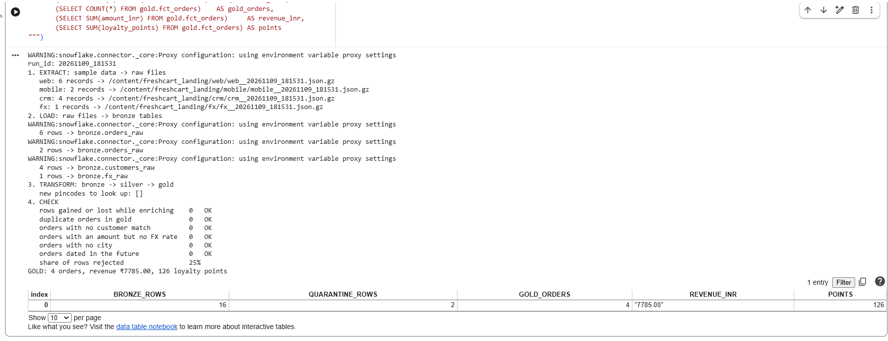

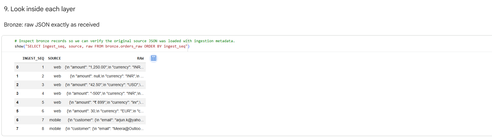

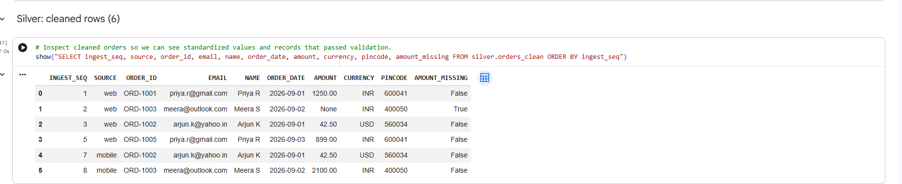

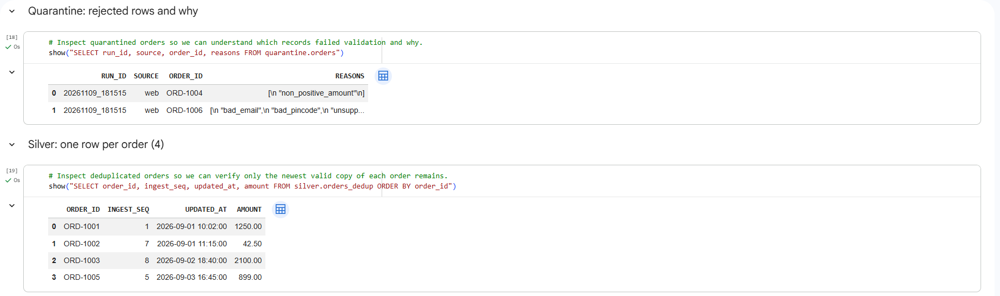

### RabbitMQ

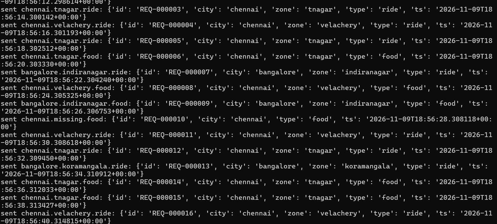

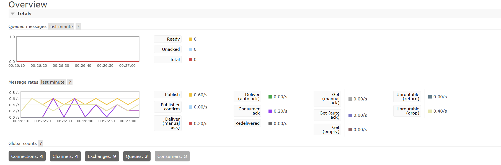

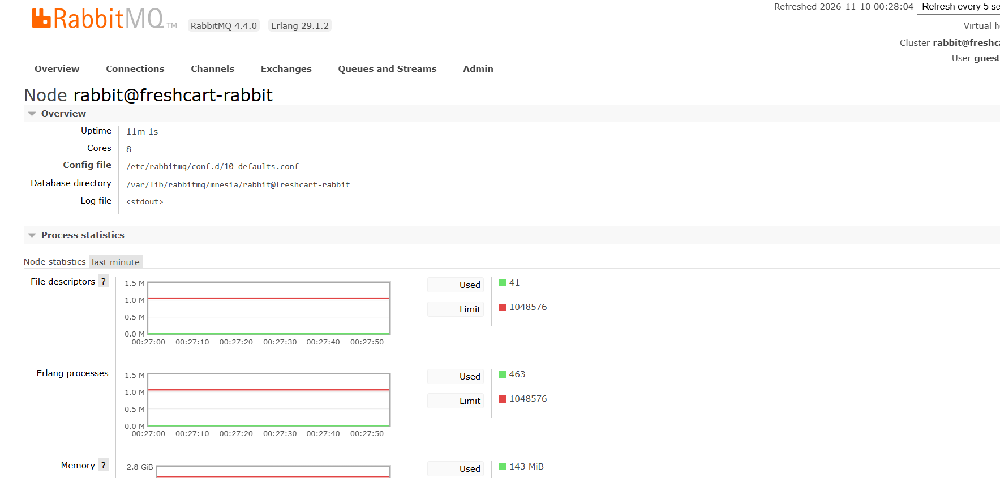

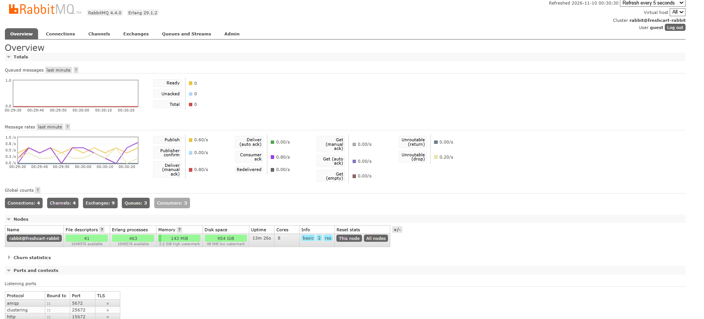

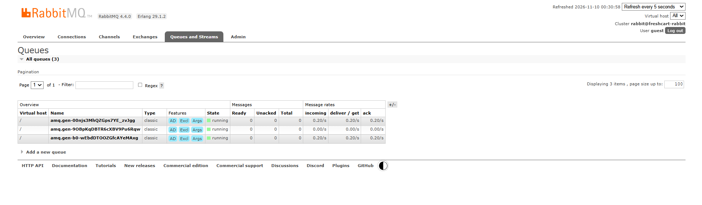

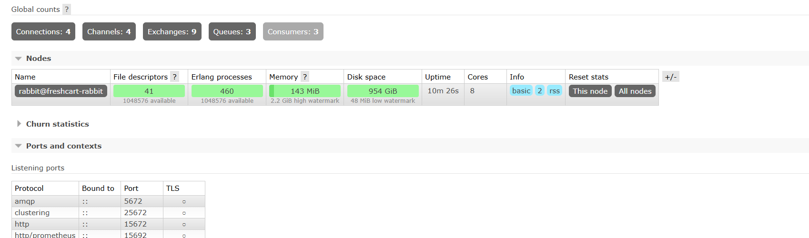

### Mage

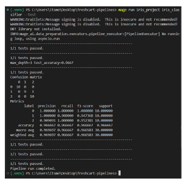

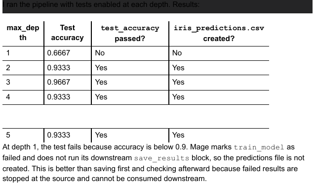

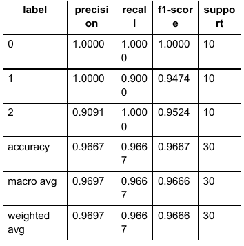

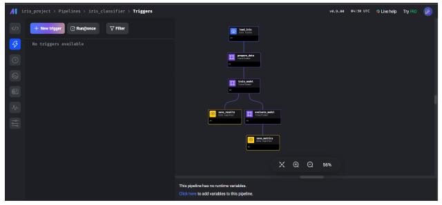
